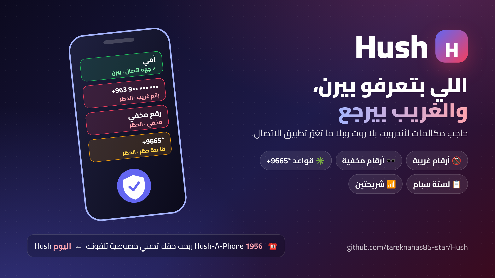

# Hush

**Call blocker for Android: the people you know ring, strangers bounce.**
**حاجب مكالمات لأندرويد: اللي بتعرفو بيرن، والغريب بيرجع.**



**[⬇️ Download APK · حمّل التطبيق](https://github.com/tareknahas85-star/Hush/releases/download/latest/block-number.apk)** &nbsp;·&nbsp; [📋 Spam list · لستة السبام](https://github.com/tareknahas85-star/block-number-data) &nbsp;·&nbsp; [English](#in-english) &nbsp;·&nbsp; [بالعربي](#بالعربي)

### Downloads · التحميل

| Item · الملف | Link · الرابط |
|---|---|
| 📘 Interactive guide, works offline · الدليل التفاعلي، بيشتغل بلا نت | [Hush-Guide.html](https://github.com/tareknahas85-star/Hush/releases/download/v1.0.0/Hush-Guide.html) |
| 📱 APK (debug build) · ملف التطبيق (نسخة تجريبية) | [block-number.apk](https://github.com/tareknahas85-star/Hush/releases/download/latest/block-number.apk) |

### Videos · الفيديوهات

- 🎬 Full walkthrough · الشرح الكامل: [youtube.com/playlist?list=PLSWzjjKqjh0U](https://www.youtube.com/playlist?list=PLSWzjjKqjh0U)
- 🪜 Step by step · خطوة بخطوة (4 episodes · 4 حلقات): [youtube.com/playlist?list=PLdR28SFPkvhk](https://www.youtube.com/playlist?list=PLdR28SFPkvhk)
### Why "Hush"?

From the 1920s to the 1950s, the **Hush-A-Phone** was a small cup you clipped onto your phone's mouthpiece so people around you couldn't hear your call. The phone company said nobody could attach anything to *its* phones. In **1956** a US appeals court sided with Hush-A-Phone: you may add something to your own phone as long as it helps you and harms no one else. It was an early step toward letting people connect their own devices to the phone network.

Hush keeps the same idea: your phone, your rules.

### ليش اسمو Hush؟

من العشرينات لحد الخمسينات، كان في قطعة اسمها **Hush-A-Phone**: كاسة صغيرة بتركّبها عسمّاعة التلفون مشان اللي حواليك ما يسمعو حكيك. شركة التلفونات قالت ممنوع حدا يركّب شي على تلفوناتها. بـ**1956** محكمة استئناف أمريكية حكمت لصالح Hush-A-Phone: من حقك تضيف شي لتلفونك طالما بيفيدك وما بيضرّ حدا. وهاد كان من أول الخطوات اللي خلّت الناس توصّل أجهزتها عشبكة التلفون.

وHush ماشي عنفس الفكرة: تلفونك، وقواعدك.

---
<a id="english"></a>

## In English

An Android app that blocks calls you do not want. It uses the official Android way to check calls, so you do not need root, and you do not need to change your phone dialer. The app is in Arabic and English.

### What it does

- Blocks any call from a number you did not save in your contacts (you can turn this on or off)
- Lets you make your own block list. You can block a whole group of numbers, for example every number that starts with `+9665`
- Keeps a list of known spam numbers on the phone
- Shows you who is calling while the phone rings, or tells you the number is unknown
- Can send you a notification when a call is blocked
- Keeps a list of blocked calls, and tells you why each call was blocked. Tap any line to block the number or copy it
- Works with two SIM cards. You can turn it on for one SIM and off for the other
- Blocks hidden and private numbers

### What you need

- Android 10 or newer
- The app asks for: your contacts, the phone state, notifications, and internet. You also give it the call screening role.

### How to build it

**With GitHub Actions (easier):** push your changes to the repo, and the app file is published on the [releases page](https://github.com/tareknahas85-star/Hush/releases/tag/latest).

**On your computer:**

```bash
gradle assembleDebug
```

The app file comes out at `app/build/outputs/apk/debug/app-debug.apk`. You need JDK 17 and the Android SDK.

### How it decides

When a call comes in, before the phone rings, the app checks it step by step:

1. Is the app off, or is this SIM excluded? Let the call in.
2. Is the number hidden? Block it, if you turned that on.
3. Is the number in your contacts? Always let it in.
4. Is the number in your block list? Block it.
5. Is the number known as spam? Block it, if you turned that on.
6. Is the number not in your contacts? Block it, if you turned that on.
7. If none of these, let the call in.

Every blocked call is saved with the reason. If the app cannot read your contacts, it lets calls in instead of blocking them.

---

## بالعربي

تطبيق أندرويد بيحظرلك المكالمات اللي ما بدك ياها. بيستخدم الطريقة الرسمية بأندرويد لفحص المكالمات، فما بتحتاج روت، وما بتحتاج تغيّر تطبيق الاتصال بتلفونك. التطبيق بالعربي والإنكليزي.

### شو بيعمل

- بيحظر أي مكالمة من رقم ما حفظتو بجهات الاتصال (بتقدر تشغّل هالشي أو توقفو)
- بيخليك تعمل قايمة حظر خاصة فيك. بتقدر تحظر مجموعة أرقام كاملة، مثلًا كل رقم بيبلش بـ `+9665`
- بيحتفظ بقايمة أرقام مزعجة معروفة جوا التلفون
- بيعرضلك مين عم يتصل وقت ما التلفون يرن، أو بيقلك إنو الرقم مجهول
- بيقدر يبعتلك إشعار لما يحظر مكالمة
- بيحتفظ بسجل المكالمات المحظورة، وبيقلك ليش انحظرت كل مكالمة. دوس على أي سطر لتحظر الرقم أو تنسخو
- بيشتغل مع شريحتين. بتقدر تشغّلو عشريحة وتوقفو عالتانية
- بيحظر الأرقام المخفية والخاصة

### شو بتحتاج

- أندرويد 10 أو أحدث
- التطبيق بيطلب: جهات الاتصال، وحالة التلفون، والإشعارات، والإنترنت. وكمان بتعطيه صلاحية فحص المكالمات.

### كيف بتبنيه

**عبر GitHub Actions (الأسهل):** ارفع تعديلاتك عالريبو، وملف التطبيق بيننشر بـ[صفحة الإصدارات](https://github.com/tareknahas85-star/Hush/releases/tag/latest).

**عجهازك:**

```bash
gradle assembleDebug
```

ملف التطبيق بيطلع بـ `app/build/outputs/apk/debug/app-debug.apk`. بتحتاج JDK 17 و Android SDK.

### كيف بيقرّر

لما تجي مكالمة، وقبل ما التلفون يرن، التطبيق بيفحصها خطوة خطوة:

1. التطبيق موقّف، أو هالشريحة مستثناة؟ بيسمح بالمكالمة.
2. الرقم مخفي؟ بيحظرو، إذا كنت مفعّل هالشي.
3. الرقم بجهات اتصالك؟ بيسمح فيو دايمًا.
4. الرقم بقايمة الحظر عندك؟ بيحظرو.
5. الرقم معروف إنو مزعج؟ بيحظرو، إذا كنت مفعّل هالشي.
6. الرقم مو موجود بجهات اتصالك؟ بيحظرو، إذا كنت مفعّل هالشي.
7. إذا ولا شي من اللي فوق انطبق، بيسمح بالمكالمة.

كل مكالمة محظورة بتنسجّل مع سببها. وإذا التطبيق ما قدر يقرا جهات اتصالك، بيسمح بالمكالمات بدل ما يحظرها.


## Contribute · ساهم معنا

Want to help? Read [CONTRIBUTING.md](CONTRIBUTING.md). Issues labelled [`good first issue`](../../labels/good%20first%20issue) are an easy start, and questions or ideas are welcome in [Discussions](../../discussions).

بدك تساعد؟ اقرا [CONTRIBUTING.md](CONTRIBUTING.md). المهام اللي عليها [`good first issue`](../../labels/good%20first%20issue) بداية سهلة، وأي سؤال أو فكرة احكيها بـ [Discussions](../../discussions).
